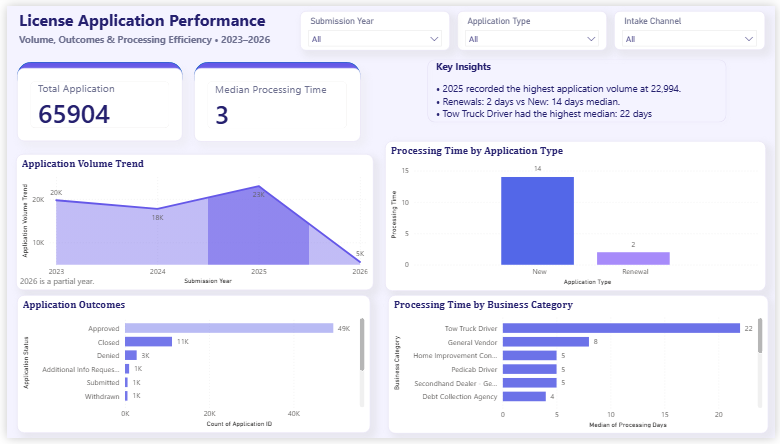

# License Application Performance Analysis

## Project Overview

This project analyzes license application data to understand application volume, processing efficiency, application outcomes, and differences across business categories, application types, and intake channels.

The project covers an end-to-end data analysis workflow, including data cleaning and validation in Python, exploratory data analysis, and the development of an interactive Power BI dashboard.

## Business Question

**How efficiently are license applications processed, and how do processing times and application outcomes vary across business categories, application types, and intake channels?**

## Tools Used

- Python
- Pandas
- Jupyter Notebook
- Power BI

## Dataset

The cleaned dataset contains **65,904 license application records** covering 2023–2026.

The analysis focuses primarily on:

- Submission Date
- Application Status
- Application Type
- Intake Channel
- Business Category
- Date Closed
- Processing Days

> **Note:** 2026 represents a partial year and should not be directly compared with complete years.

## Data Cleaning

The dataset was inspected and cleaned in Python before analysis.

Key cleaning and validation steps included:

- Converted submission and closure dates to datetime format.
- Created `Processing Days` using Submission Date and Date Closed.
- Identified **44 records** where Date Closed occurred before Submission Date.
- Retained those records for volume and outcome analysis but excluded their invalid durations from processing-time analysis.
- Investigated missing closure dates rather than automatically treating them as pending applications.
- Checked repeated Application IDs and found that the associated records differed, so they were retained.
- Preserved missing values in optional fields rather than dropping otherwise valid applications.

After cleaning, the dataset remained at **65,904 records**.

## Key Findings

### Application Volume

Application volume declined from **19,723 applications in 2023** to **17,727 in 2024**, before increasing to **22,994 in 2025**.

The increase from 2024 to 2025 was approximately **29.7%** and was driven primarily by renewal applications.

### Processing Efficiency

The overall median processing time was **3 days**.

The mean processing time was approximately **21.4 days**, substantially higher than the median. This indicates a right-skewed distribution, with some applications taking considerably longer to process.

### New vs Renewal Applications

New applications had a median processing time of **14 days**, compared with **2 days for renewal applications**.

This represents an association observed in the dataset and does not by itself establish that application type causes the difference.

### Application Outcomes

Approved applications were the most common outcome.

Among applications with an explicit **Approved or Denied** status, approximately **94.7% were Approved**.

### Business Categories

**Home Improvement Contractor** was the largest business category, accounting for approximately **24.5% of all applications**.

Among the 15 highest-volume categories, **Tow Truck Driver** stood out with a median processing time of approximately **22 days**, compared with the overall median of 3 days.

## Power BI Dashboard

The interactive Power BI dashboard includes:

- Total Applications KPI
- Median Processing Time KPI
- Application Volume Trend
- Application Outcomes
- Processing Time by Application Type
- Processing Time by high-volume Business Category
- Filters for Submission Year, Application Type, and Intake Channel

## Dashboard Preview



## Repository Structure

```text
License-Application-Performance-Analysis/
│
├── data/
│   └── cleaned_license_applications.csv
│
├── notebooks/
│   └── license_analysis.ipynb
│
├── dashboard/
│   └── License_Application_Dashboard.pbix
│
├── images/
│   └── dashboard.png
│
└── README.md
```

## Skills Demonstrated

- Data cleaning and validation
- Exploratory data analysis
- Data quality investigation
- Python and Pandas
- Data visualization
- Power BI dashboard development
- Business-focused data interpretation
- Communicating analytical findings

## Conclusion

The analysis shows that typical license applications are processed relatively quickly, with a median processing time of **3 days**, but processing time varies substantially across application types and business categories.

Renewal applications were typically processed faster than new applications, while Tow Truck Driver applications showed notably longer processing times among high-volume categories.

The interactive dashboard allows users to explore these patterns across years, application types, intake channels, outcomes, and business categories.
